# ParentTeacher Connect Portal

> **A Complete, Family-Friendly School Collaboration Web Platform**  
> **Architecture:** Pure Frontend-Only (HTML5, CSS3, Vanilla JavaScript ES6+)  
> **Theme:** Primary Pink `#EC4899`, Light Pink `#FCE7F3`, White `#FFFFFF`, Dark Text `#1F2937`  
> **Persistence:** HTML5 LocalStorage with comprehensive Indian school seed fallback

---

## 1. Project Overview

**ParentTeacher Connect** is a responsive, web-based platform designed for Indian schools to bridge communication between parents, teachers, and school administrators. By eliminating paper diaries, fragmented WhatsApp groups, and delayed fee notices, the portal provides a single, transparent hub for:

- **Academic Tracking:** Real-time subject-wise grades, marks, and teacher feedback.
- **Attendance Monitoring:** Morning roll-call status with cumulative percentage meters.
- **Fee Management:** Instant online fee settlement with downloadable receipt numbers.
- **Direct Messaging:** Two-way private messaging with unread alerts and reply threads.
- **PTM Scheduler:** One-on-one conference booking with automated meeting links.
- **Campus Bulletin:** Official circulars, sports day schedules, and holiday announcements.
- **Institutional Reports:** Exportable attendance, fee collection, and gradebook CSV files.

---

## 2. Tech Stack

- **HTML5:** Semantic architecture (`<header>`, `<nav>`, `<aside>`, `<main>`, `<section>`, `<article>`)
- **CSS3:** Custom properties (CSS variables), CSS Grid, Flexbox, smooth transitions, print styles, and dark mode
- **Vanilla JavaScript (ES6+):** Pure client-side logic, hash routing, role-based view dispatching, and CRUD operations
- **CDNs:** Font Awesome 6 (iconography) and Google Fonts (`Poppins` & `Inter`)
- **Data Layer:** Zero external database or backend required. All data persists in `localStorage` with seed fallback.

---

## 3. Demo Credentials & 1-Click Switcher

The application features a **1-Click Demo Login Bar** on the landing page and a **Role Switcher** in the top bar of the dashboard.

| Role | User Name | Email | Password | Scope & Privileges |
| :--- | :--- | :--- | :--- | :--- |
| **Parent** | Priya Sharma | `priya@email.com` | `parent123` | View child portfolio (Aarav & Diya), marks, attendance, pay fees, message teachers, book PTM |
| **Teacher** | Suresh Iyer | `suresh@school.edu` | `teacher123` | Assigned Class 8-A, mark attendance, record grades, post homework, accept PTM meetings |
| **Admin** | Dr. Rameshwar Rao | `admin@school.edu` | `admin123` | Full CRUD over parents, teachers, and students; view all messages, fee collections, export CSV reports |

---

## 4. Folder Structure

```
parent-teacher-portal/
├── index.html        # Landing page, feature overview, demo buttons, login/register modals
├── dashboard.html    # Single-page application shell (Parent, Teacher, and Admin views)
├── style.css         # Responsive styles, pink theme variables, animations, dark mode
├── data.js           # Sample dataset (Indian names) & LocalStorage management helpers
├── script.js         # Core application logic, routing, role-based rendering & CRUD
└── README.md         # Documentation, report outline, video script, commit roadmap
```

---

## 5. How to Run Locally

### Option A: Direct Browser Launch (Zero Installation)
Simply double-click `index.html` in your file explorer. It will open directly in any modern browser (Chrome, Edge, Firefox, Safari) with all features working.

### Option B: Local HTTP Server (Recommended)
```bash
# Using Python 3
cd parent-teacher-portal
python -m http.server 8080

# Or using Node.js npx
npx serve -l 8080
```
Open your browser and navigate to: **`http://localhost:8080`**

---

## 6. Screenshots & Feature Gallery

Below are the actual screenshots captured from the running application:

### 1. Landing Page & 1-Click Demo Login Bar
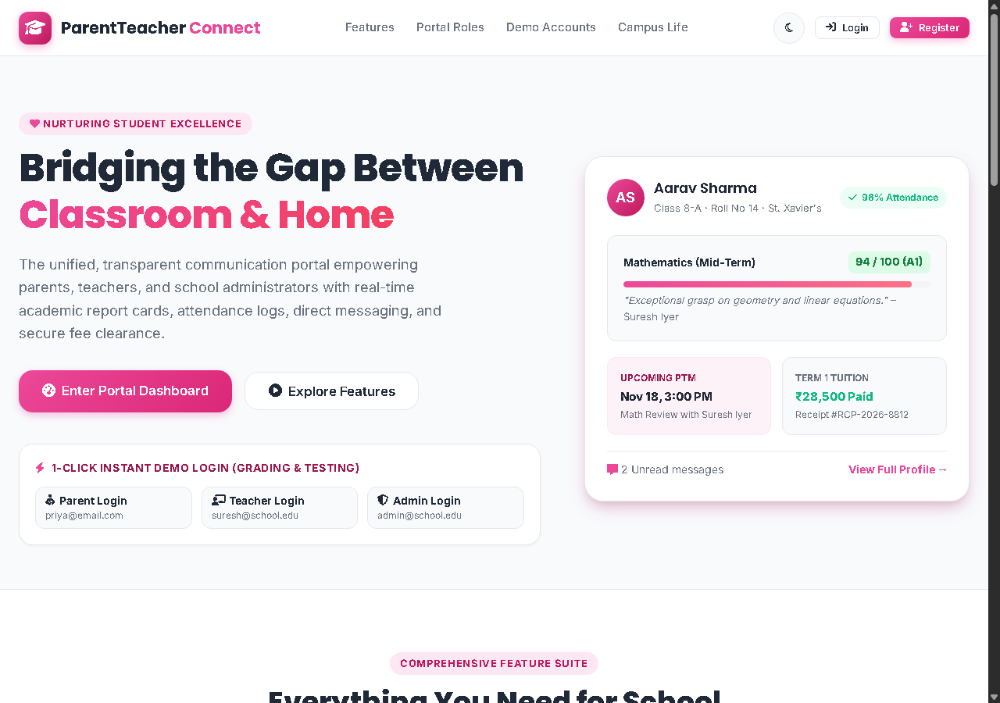

### 2. Parent Dashboard & Student Portfolio (Aarav Sharma)
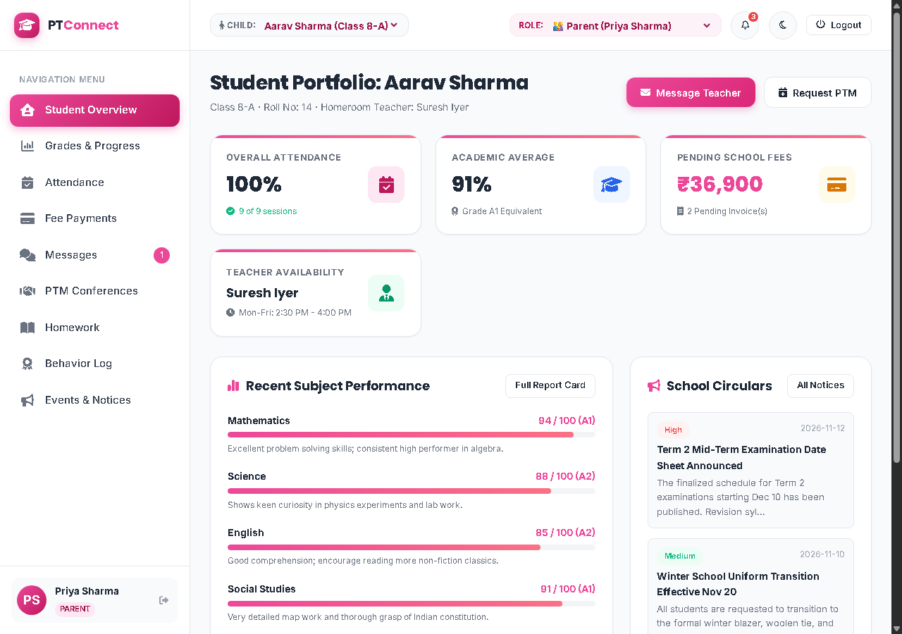

### 3. Academic Report Card & Progress Meters
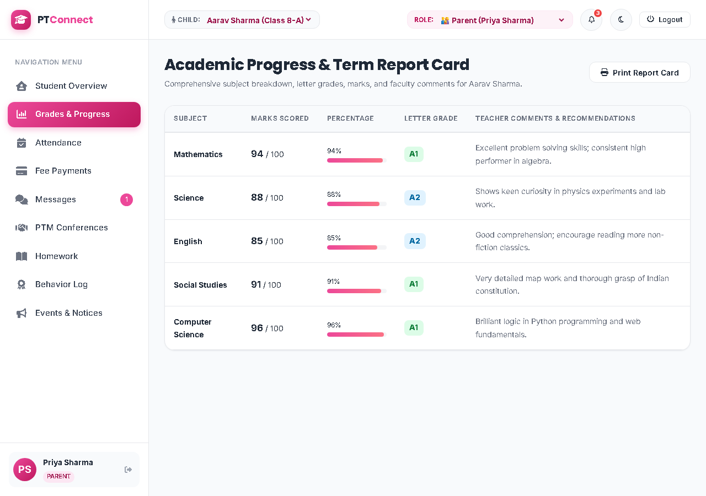

### 4. Daily Attendance Tracker & Punctuality Meter
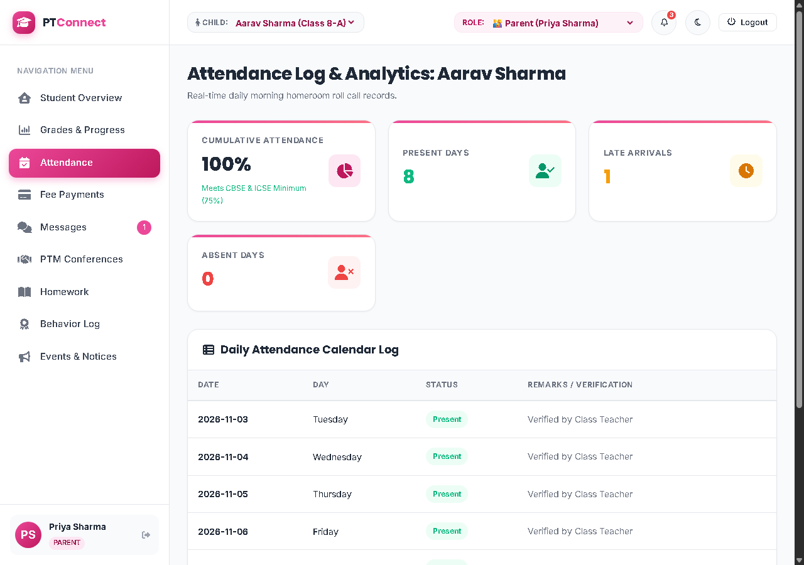

### 5. Fee Payments & Online Invoicing
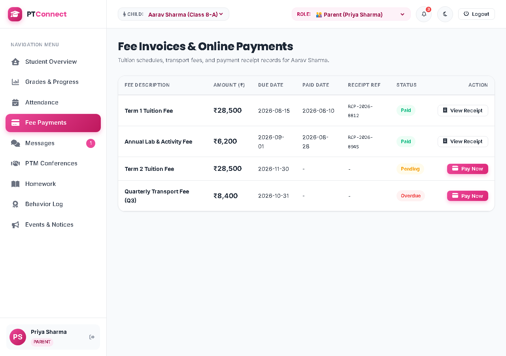

### 6. Two-Way Direct Messaging Hub (Inbox & Outbox)
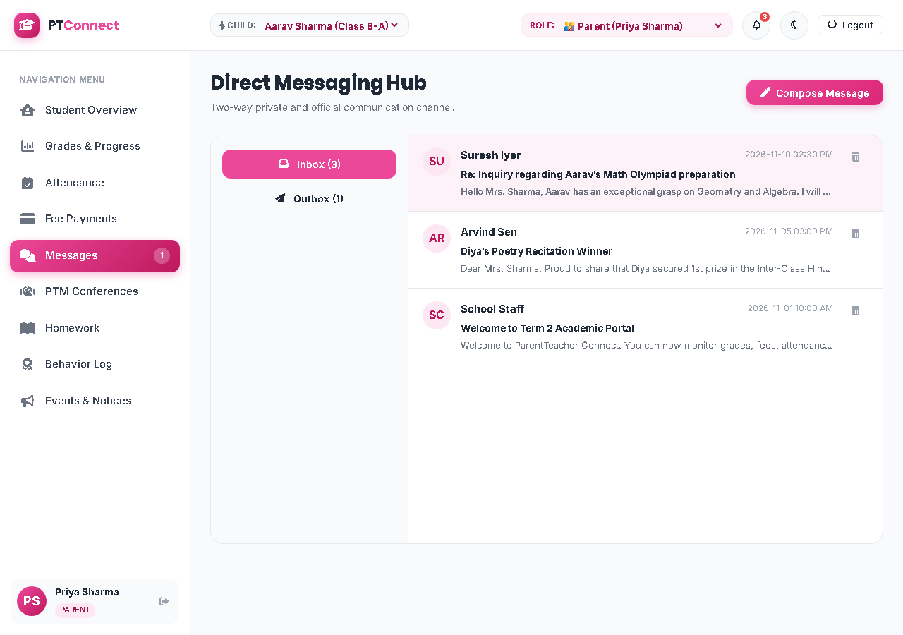

### 7. Parent-Teacher Conferences (PTM) Scheduler
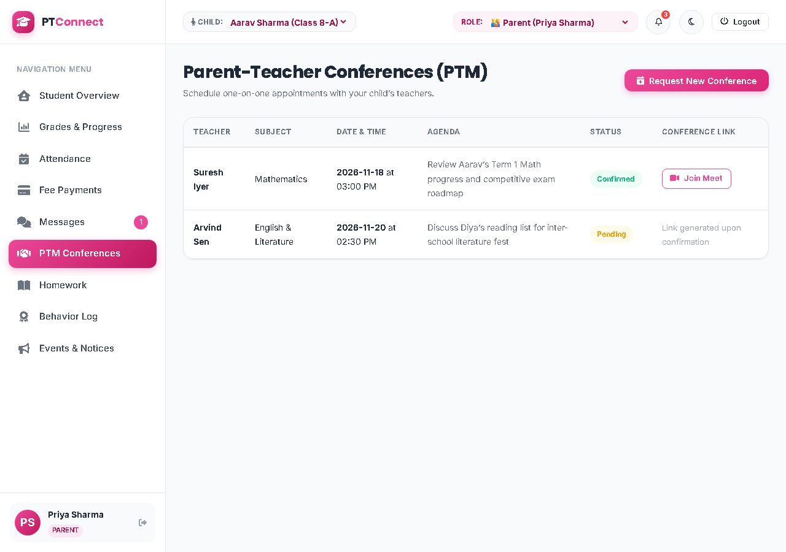

### 8. Teacher Command Deck (Class 8-A Homeroom)
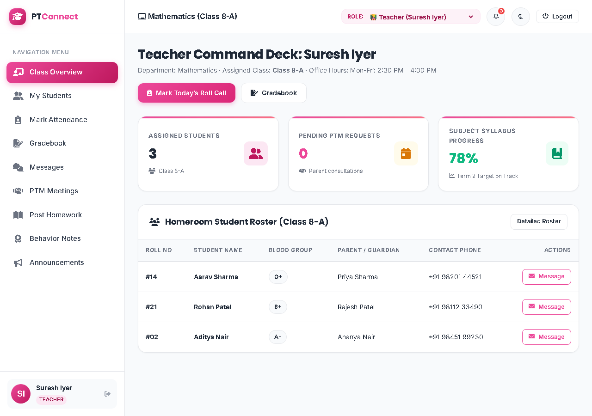

### 9. Daily Morning Roll Call Marker (Teacher)
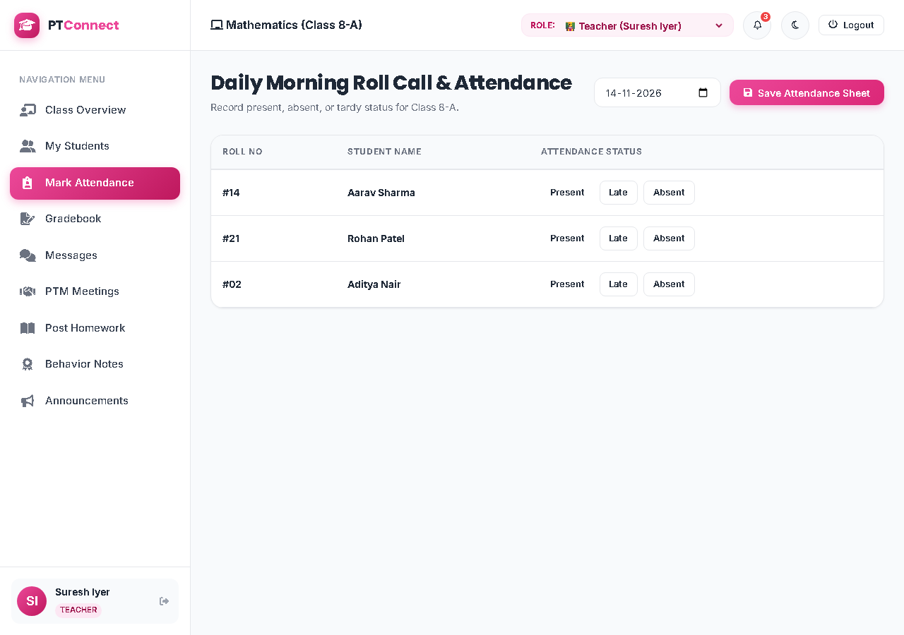

### 10. Gradebook & Assessment Management (Teacher)
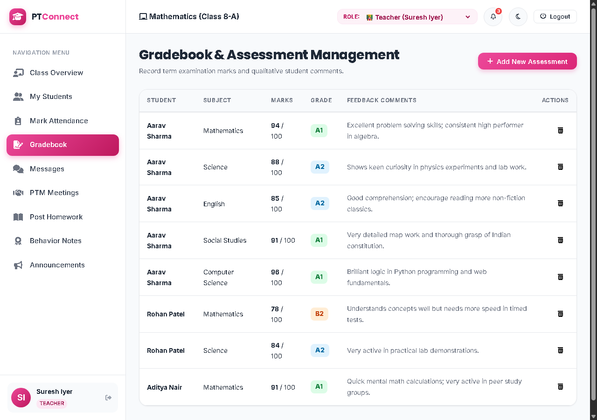

### 11. Central Administrative Console & Telemetry (Admin)
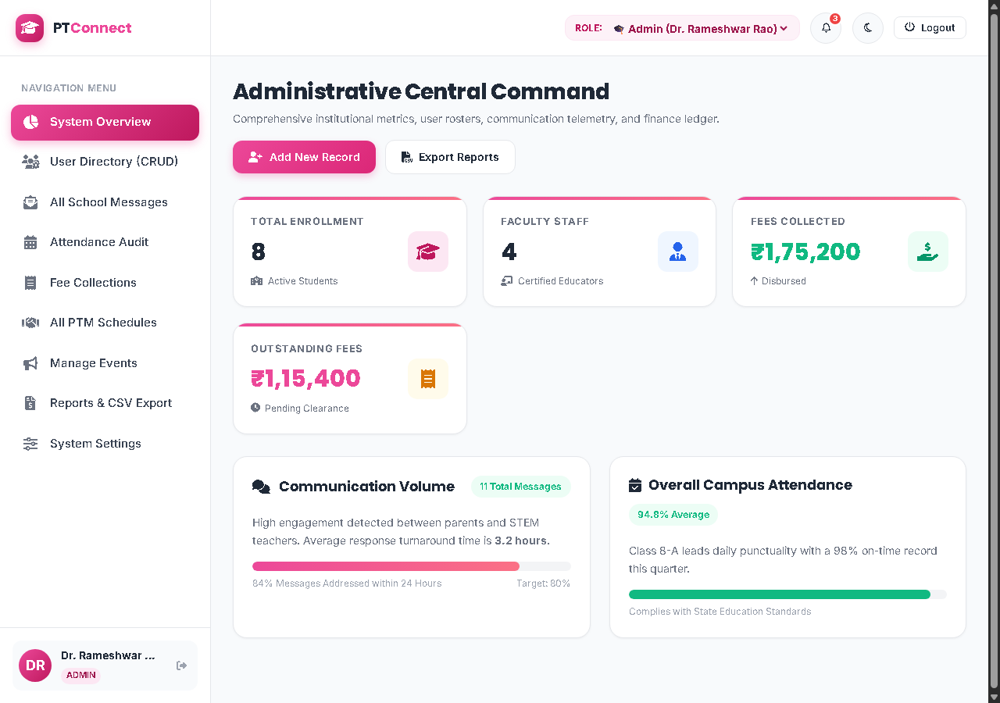

### 12. Institutional Reports & CSV Export Engine (Admin)
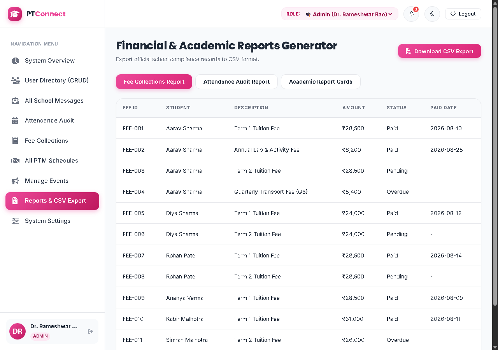

### 13. Mobile Responsive View (iPhone Viewport)
<p align="center">
  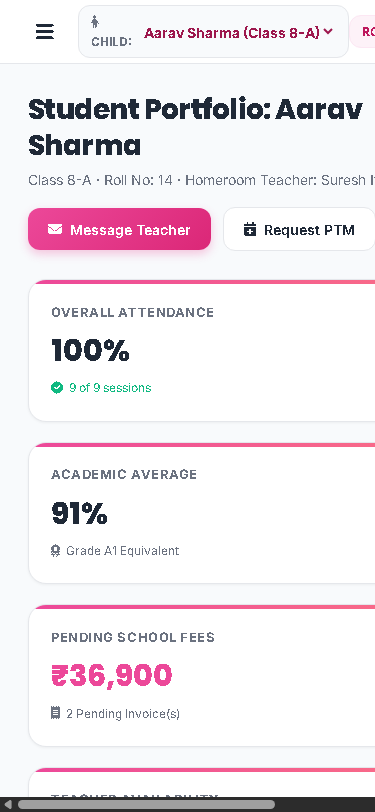
</p>

---

## 7. Project Report Outline (1 to 2 Pages)

### I. Objective
To design and build an intuitive, frontend-only Parent-Teacher collaboration portal tailored to Indian K-12 educational institutions that centralizes academic tracking, daily roll call, fee settlement, and communication into an accessible, role-governed web application.

### II. Technologies Used
- **Semantic HTML5:** Native accessible controls, labelled forms, and modal dialogs.
- **CSS3 Design System:** Warm pink identity (`#EC4899`, `#FCE7F3`), CSS Grid, media queries, print media stylesheets, and dark mode.
- **Vanilla JavaScript:** Event-driven architecture, modular functions, LocalStorage abstraction, and dynamic CSV string builder.

### III. Key Features Implemented
- **Role-Based Access Control:** Distinct interfaces and navigation for Parent, Teacher, and Admin personas.
- **Child Selector:** Dynamic switching for parents with multiple enrolled children.
- **Attendance System:** Daily roll call for teachers; percentage calculation and log for parents.
- **Fee Settlement:** Real-time status update from *Pending* / *Overdue* to *Paid* with auto-generated receipt numbers.
- **Two-Way Messaging:** Real-time inbox and outbox with unread count badges and simulated email dispatch toasts.
- **PTM Scheduler:** Interactive appointment booking with instant Google Meet link generation upon teacher acceptance.
- **Compliance Reporting:** Export of official fee and attendance ledgers to downloadable `.csv` files.

### IV. Learning Outcomes & Engineering Challenges
- **Data Normalization in Frontend State:** Establishing relational links across entities (e.g., Parent &rarr; Student &rarr; Teacher &rarr; Attendance &rarr; Fees) in JavaScript arrays without a relational SQL database.
- **Responsive Layout Architecture:** Managing multi-column tables, stat cards, and messaging sidebars on mobile viewports using flexible CSS scroll wrappers (`.table-responsive`).
- **Input Validation & Security:** Sanitizing user input, validating email/phone formats, and preventing XSS vulnerabilities.

---

## 8. 3 to 5 Minute Demo Video Script

- **[0:00 - 0:45] Introduction & Landing Page**  
  *"Hello everyone. Today I'm presenting ParentTeacher Connect, an all-in-one portal connecting parents, teachers, and school administrators. Notice our warm, family-friendly pink theme designed to make school engagement welcoming. On the landing page, we can see features, campus highlights, and our 1-click demo login buttons for Parent, Teacher, and Admin."*

- **[0:45 - 1:45] Parent Portal Walkthrough (Priya Sharma)**  
  *"Let's click 'Parent Login' to sign in as Priya Sharma. In the top bar, notice our child selector. Priya has two children in the school: Aarav in Class 8-A and Diya in Class 5-B. Switching between them instantly updates the attendance percentage, academic grades, and pending fees. Let's head to Fee Payments. Here we have a pending Term 2 Tuition fee of ₹28,500. Let's click 'Pay Now', select UPI, and authorize. Instantly, the status updates to 'Paid', a receipt reference is generated, and a simulated email notice is dispatched."*

- **[1:45 - 2:45] Teacher Portal Walkthrough (Suresh Iyer)**  
  *"Next, let's use our topbar role switcher to switch to Suresh Iyer, the Class 8-A Mathematics teacher. As a teacher, my navigation adapts immediately. Let's navigate to 'Mark Attendance'. Here is the morning roll call sheet for Class 8-A. I can mark students Present, Late, or Absent with single clicks and click 'Save Attendance Sheet'. Next, in the Gradebook, I can add a new term assessment with qualitative feedback that instantly reflects in the parent's report card."*

- **[2:45 - 3:45] Admin Portal & Reporting (Dr. Rameshwar Rao)**  
  *"Now, let's switch to the Principal / Admin persona. As an administrator, I have complete oversight. In 'User Directory', I can perform full CRUD operations to add, edit, or delete students, teachers, and parents. Under 'All School Messages', I can audit communication. Finally, in 'Reports', I can preview fee collections, attendance audits, or academic report cards, and click 'Download CSV Export' to generate a file ready for school board compliance."*

- **[3:45 - 4:15] Mobile View & Dark Mode**  
  *"Notice our responsive hamburger menu that smoothly slides out on mobile screens, and our one-click Dark Mode toggle that preserves our signature pink branding while reducing eye fatigue. When you refresh the browser, all data remains intact thanks to our HTML5 LocalStorage persistence."*

- **[4:15 - 4:30] Conclusion**  
  *"ParentTeacher Connect delivers a fast, zero-dependency, and accessible experience for Indian schools. Thank you!"*

---

## 9. Suggested Git Commit Roadmap

```bash
Day 1: "feat: setup project structure, Indian school data model and data.js helpers"
Day 2: "feat: build responsive landing page and login/registration modals in index.html"
Day 3: "style: implement pink theme variables, card layout, animations, and dark mode"
Day 4: "feat: develop parent portal with child selector, grades, attendance, and fee payment"
Day 5: "feat: develop teacher portal with daily attendance marker and assessment gradebook"
Day 6: "feat: develop admin console with user CRUD, PTM conference scheduler, and CSV export"
Day 7: "test: integrate messaging unread counters, simulated email toasts, and documentation"
```

---

## 10. Future Enhancements

- Online Quiz & Poll module for instant student feedback.
- Automated SMS / WhatsApp webhook gateway integration.
- Timetable & substitution planner for academic faculty.
- Bus live GPS tracking integration with Indian transit APIs.

